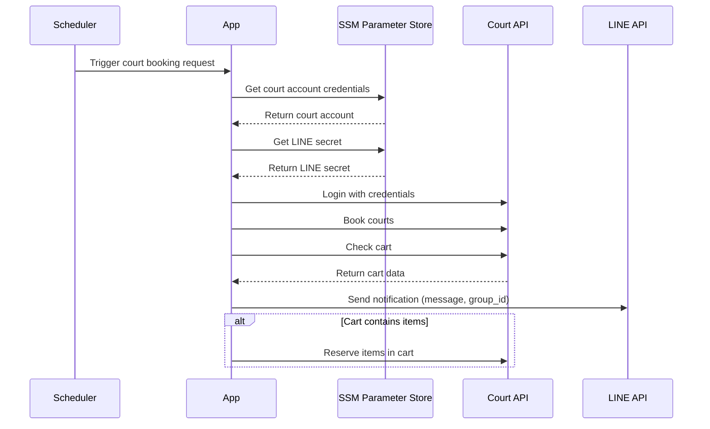
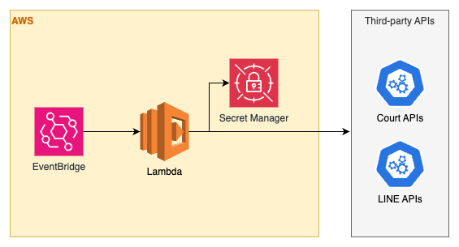
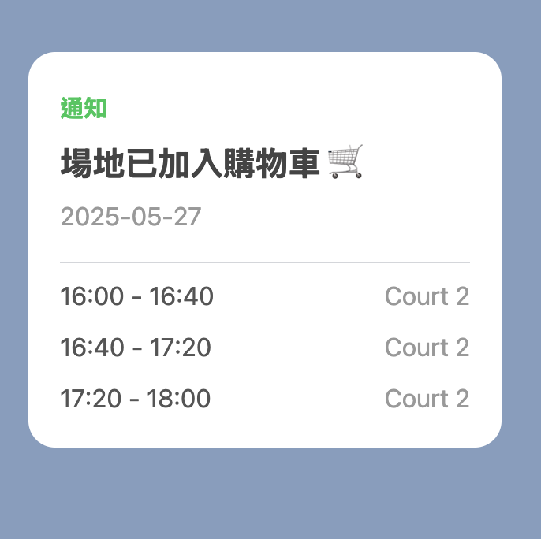

# Badminton Bot

Automates badminton court booking via third-party APIs and LINE notifications.

---

## How it Works

1. Use the court API to log in, and explicitly set the User-Agent header to help prevent the website from
   detecting the script as a bot.
2. Fetch available slots and attempt to reserve them by adding to the cart.
3. Continuously retry the reservation process to secure the slots as early as possible.
4. Send the notification to LINE group
5. Monitor the cart after adding items — if any items are removed by the admin, attempt to re-add them automatically.

---

### Booking Flow Sequence Diagram



---

## Architecture



---

### Event Bridge

Define scheduled events to automatically trigger the lambda function when the reservation is available

Sample event:

```
{
     "accountId": "1",
     "location": "queensbridge-sports-community-centre",
     "activity": "badminton-40min",
     "keyword": "Court 1,Court 3",
     "day_offset": 7,
     "slots": [
         {
             "start_time": "11:00",
             "end_time": "11:40"
         },
         {
             "start_time": "11:40",
             "end_time": "12:20"
         }
     ]
 }
```

---

### SSM Parameter Store

Store the account details (username, password) and LINE secrets as SecureStrings in AWS Systems Manager Parameter Store to save costs. The lambda function fetches them by path (e.g., `account_1`, `line_secret`).

---

## Multi-Account Booking Strategy & Optimizations

To maximize the probability of booking available courts across multiple accounts without internal collision:

1. **Orthogonal Target Ordering (錯開首選目標)**:
   - **Account 1**: `["Court 1", "Court 3", "Court 2"]` (首選 Court 1，次選 Court 3，保底 Court 2)
   - **Account 2**: `["Court 2", "Court 3", "Court 1"]` (首選 Court 2，次選 Court 3，保底 Court 1)
   - 雙帳號第一擊（Round 1）首選完全錯開，避免內部互踩；將未被列為首選的 Court 3 作為第一備援，當任一帳號首選遇外部競爭時能以最高機率撿漏。

2. **Low-Latency Polling & Fast Failover (低延遲輪詢與重試)**:
   - 查詢重試間隔（`SLEEP_INTERVAL` 與 `interval_seconds`）由原本的 `1s` 調降為 `0.15s`，避免因伺服器延遲數毫秒開門而白白浪費 1~3 秒黃金時間。
   - 加購物車重試間隔（`add_interval_seconds`）縮短為 `0.1s`，失敗時以最快速度切換至備援場地。

3. **Lambda Compute Sizing (CPU 算力提升)**:
   - Lambda `memorySize` 設定為 `512 MB`，確保 AWS Lambda 分配到充足的 vCPU 算力，消除多執行緒並行查詢時的 TLS 加密與 JSON 解析爭搶（Throttling）。

4. **Observability (毫秒級延遲日誌)**:
   - 每次加入購物車（`client.add`）皆記錄精確毫秒級 RTT 耗時與結果狀態，利於開搶後精準復盤。

---

## Local Development & Testing

You can run the application locally to test the booking flow with a sample request.

### Setup
```bash
make setup
```

### Run Local Test
By default, running the app locally uses the `dev` environment (loads `line_secret_dev`).
```bash
make run-dev
```

### Run Tests
```bash
make test
```

---

## UI - LINE Notifications

Integrated LINE API to send the flex message to target group

